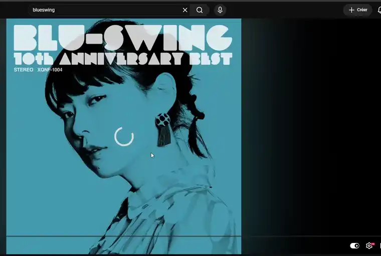
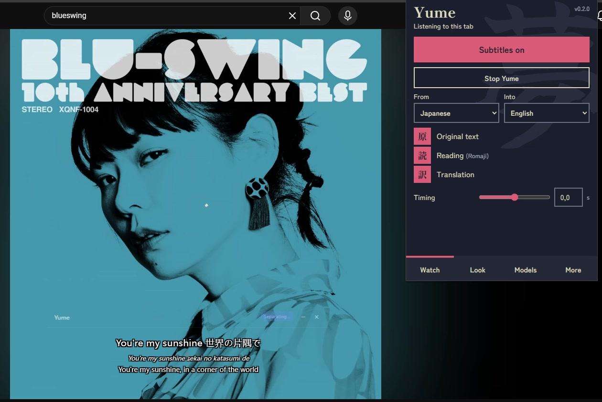
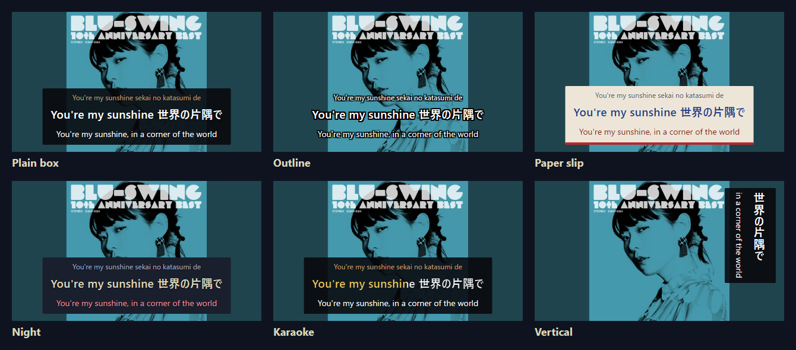
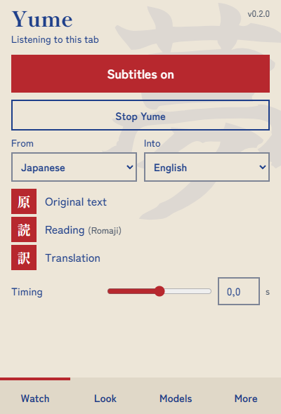
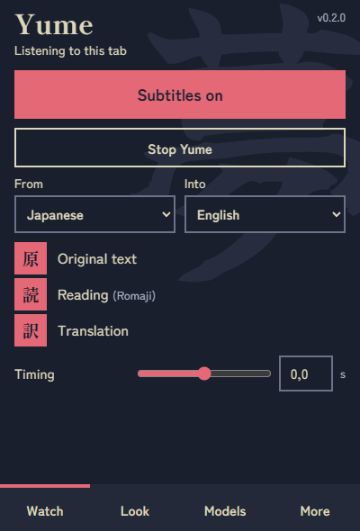
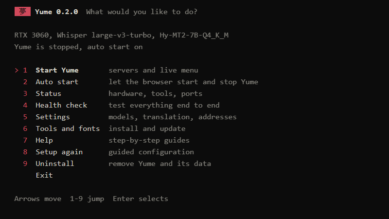
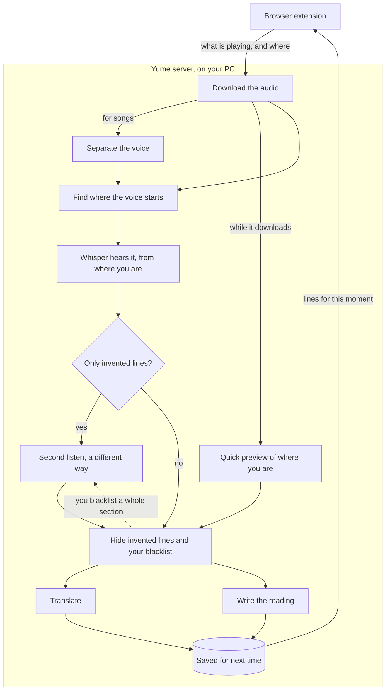

<div align="center">


**You'll Understand More Easily.** Subtitles for any video, made on your own computer.


[](LICENSE)

</div>

Yume listens to the video you are watching, writes down what is said, translates it and shows it on the video. It all happens on your PC, with no cloud service and no account. It was made for songs and talks in **Japanese, Chinese, Korean, Russian and Arabic**, and you can see the original, how it is read, and the translation together.

<a href="https://github.com/jenox645/Yume/releases/download/v0.2.0/Yume-demo.mp4"></a>

<p align="center"><a href="https://github.com/jenox645/Yume/releases/download/v0.2.0/Yume-demo.mp4">Watch the demo with sound</a></p>

## See it

Press one button in your browser. Yume starts by itself, and stops by itself when you are done.



Six subtitle styles. Pick one in the Look tab. Vertical is for Japanese and Chinese.



Light and dark, and a terminal for everything else.

<p align="center">
  
  
</p>



## Get started

You need Python 3.10 or newer. A graphics card helps a lot, but a CPU works.

**1. Install.** Download this repository and run the file for your system. A setup wizard checks your hardware and installs everything, including the models.

| Windows | Linux | macOS |
|---|---|---|
| Double-click `START_YUME.bat` | `./START_YUME.sh` | Double-click `START_YUME.command` |

When the wizard offers auto start, say yes. You will not need the terminal again.

**2. Add the extension.** In Chrome, Brave or Edge:

1. Open `chrome://extensions` and turn on **Developer mode**.
2. Click **Load unpacked** and choose the `extension` folder.
3. Pin the Yume icon.

In Firefox 121 or newer, open `about:debugging`, choose **This Firefox**, then **Load Temporary Add-on**, and pick `extension/manifest.json`. Firefox forgets temporary add-ons when it closes, so this step repeats after each restart.

**3. Watch.** Open a video, click the Yume icon, pick the video's language, and press **Turn subtitles on** (or Alt+Y). The first start takes about 30 seconds while the models load.

## Auto start

With auto start on, pressing **Turn subtitles on** starts Yume in the background, with no window and no terminal. It stops by itself after 30 minutes without a video, and the popup has **Start Yume** and **Stop Yume** buttons.

The first start takes about 30 seconds while the models load. Turn it on or off in the terminal menu, under **Auto start**, where you can also change the idle time or set it to never stop. From the command line:

```bash
python pocket_yume.py autostart on
```

Without it, start Yume yourself with `START_YUME` before you watch.

## How good is it?

These numbers come from our own tests on an RTX 3060 with 12 GB, using Whisper `large-v3-turbo` and Hy-MT2-7B. They depend on those models: swap one and your results change, for better or worse. Your hardware and videos will differ too.

**Accuracy.** We scored Yume against captions and lyrics written by people, on 26 talks and 13 songs. Lower is better.

| Wrong, in % | Japanese | Chinese | Korean | Russian | Arabic |
|---|---|---:|---:|---:|---:|
| Talks | 9.1 | 6.2 | 11.3 | 18.5 | 17.4 |
| Songs | 7.5 | 24.2 | 6.1 | 8.7 | 50.5 |

Songs are hard, and Arabic songs are not reliable yet. Korean has only 3 talks and 2 songs behind it, and Russian and Arabic have 2 songs each, so treat those as a rough guide. The method and every rejected idea are in [tests/gold/RESULTS.md](tests/gold/RESULTS.md).

**Speed.**

| | Time |
|---|---|
| First subtitle of a new video, Yume already running | About 10 s |
| Opening a video at 10:00 | About 12 s |
| A video you have watched before | Instant |
| Hearing one 25 s section | About 1 s |
| Translating 10 lines | About 3 s |

**Noise.** Yume keeps 40 to 80 seconds ready ahead of you and lets the GPU rest in between. While watching, it was busy 34 seconds out of 150, at about 49 W on average. When it rests, the window says how far it is ready, for example "Ready to 1:37".

## Choosing your models

Yume is not tied to one model. Two do the work, and you can swap either one.

**Whisper hears the audio.** Change it in the popup, under **Models**, or in the terminal. The switch happens while Yume runs:

```bash
python pocket_yume.py model list
```

| Model | Memory on the GPU | In our tests |
|---|---|---|
| **large-v3-turbo** | 2.4 GB | The default: the best balance on any GPU |
| large-v3 | 4.4 GB | Slightly better on songs, about 2.5× slower. No gain on talks |
| small, base, tiny | Less | For a CPU or a small card, less accurate |

Each model keeps its own saved transcripts, so a video is heard again after a switch. If you are not sure, `python pocket_yume.py recommend` suggests one for your card.

**The translator turns the lines into your language.** Pick one in the terminal: **Settings**, then **Translation settings**. Any GGUF model works, and so do Ollama, LM Studio and other OpenAI-compatible servers.

| Model | Size | For | In our tests |
|---|---|---|---|
| **Hy-MT2-7B Q4_K_M** | 4.6 GB | Most people | Half the serious errors of Qwen2.5-7B, at about the same speed |
| Hy-MT2-1.8B Q4_K_M | 1.1 GB | Small cards, quieter fans | About as good as Qwen2.5-7B, 2.5× faster |
| Qwen2.5-7B | About 4 GB | Custom prompts | The older default |

Both models share your GPU's memory, so check that the pair fits. The comparisons are in [tests/gold/RESULTS.md](tests/gold/RESULTS.md). They rest partly on one person's blind reading, and French on only 4 clips.

## What you need

| | Minimum | Better |
|---|---|---|
| **Graphics** | None, a CPU works | NVIDIA with 8 GB or more |
| **Memory** | 8 GB | 16 GB |
| **Disk** | 5 GB | 15 GB, plus 3.5 GB for vocal isolation |
| **Python** | 3.10 | 3.11 or newer |

NVIDIA is the best supported. AMD works on Linux, and everything else runs on the CPU. We test on Windows; macOS and Linux get less testing.

## What it can't do

- **Live streams:** Yume needs the whole recording, so it works once a stream has ended.
- **Protected video:** Netflix and most paid services can't be read. Yume works where [yt-dlp](https://github.com/yt-dlp/yt-dlp) can download the audio. We test YouTube, NicoNico, Bilibili and Twitch.
- **Perfect lyrics:** Whisper still mishears songs. If it invents a line, report it from the popup: the line stays hidden and Yume listens to that part again.
- **Skipping ahead for free:** a jump past what is ready takes a few seconds to catch up. Export only covers the parts already heard.

## Your data

Everything runs on your machine. The server listens only on your own computer and needs a private token, and only the Yume extension can talk to it. To download audio, Yume connects to the video's site. If YouTube refuses a download, it can read your browser's YouTube cookies, without changing them. The details are in [docs/SECURITY.md](docs/SECURITY.md).

## If something goes wrong

Start with this. It tests every part, including a real translation:

```bash
python pocket_yume.py health
```

| Problem | Try |
|---|---|
| "Yume is not running" | `python pocket_yume.py autostart on`, then reload the extension |
| "Yume could not start" | The message says why. Logs are in the `logs` folder |
| YouTube asks you to sign in | In the terminal: **Settings**, then **YouTube Auth** |
| No translation | Check the translator with `python pocket_yume.py health` |
| Port already in use | `python pocket_yume.py ports` |
| Too slow | A smaller model helps: `python pocket_yume.py recommend` suggests one for your card |

## How it works



Whisper only works ahead of where you are. When 80 seconds are ready it rests, and it starts again when 40 are left, so a video you leave costs no more GPU time.

More in [docs/ARCHITECTURE.md](docs/ARCHITECTURE.md). All terminal commands are listed by `python pocket_yume.py help`.

## More

- [Changelog](docs/CHANGELOG.md)
- [Contributing](docs/CONTRIBUTING.md)
- [Developer guide](docs/DEVELOPER_GUIDE.md)

This is a personal project and still has rough edges. Bug reports are welcome.

MIT license. Bundled fonts are under the SIL Open Font License, see [extension/fonts](extension/fonts).
